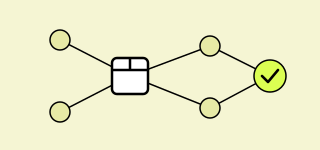

Every method in the toolbox, grouped by the environmental question it helps with. Pick a theme to jump to its methods, or press <kbd>Ctrl</kbd> + <kbd>K</kbd> (<kbd>⌘</kbd> + <kbd>K</kbd> on Mac) to search.
<!-- ───────────── Themes ───────────── -->

(explore-by-theme)=
## Explore by theme

::::{grid} 1 2 2 4
:class: edst-themes

:::{card} Climate, land & Earth observation
:link: #theme-climate

**3 methods** — correcting climate models, satellite crop mapping and risk to terrestrial carbon.
:::

:::{card} Biodiversity & species
:link: #theme-biodiversity

**3 methods** — joint species distribution models, indicator uncertainty and drivers from species accounts.
:::

:::{card} Pollution & chemical exposure
:link: #theme-pollution

**5 methods** — non-target mass spectrometry, metals and PFAS, censored water-quality data.
:::

:::{card} Data integration & FAIR foundations
:link: #theme-data

**3 methods** — packaging data with RO-Crate, testing whether combining datasets pays off, and joining monitoring data through river networks.
:::
::::

<!-- ───────────── Methods, grouped by theme ───────────── -->

(all-methods)=
## All methods

(theme-climate)=
### Climate, land & Earth observation

::::{grid} 1 1 2 3
:class: edst-methods edst-climate

:::{card} Bias Correction of Climate Models
:link: ./methods/ds-toolbox-notebook-biascorrection/bias-correction.ipynb
:footer: Bayesian
**Concepts:** Gaussian processes, Bayesian hierarchical modelling

**Data:** climate model output, in-situ weather station measurements
:::

:::{card} Fine-Tuning a Geospatial Foundation Model for UK Crop Classification
:link: ./methods/uk-crop-classification-prithvi/prithvi-uk-crop-fine-tuning.ipynb
:footer: AI & ML · Geospatial
**Concepts:** geospatial foundation models, semantic segmentation, multi-temporal classification

**Data:** UKCEH Land Cover plus: Crops, Sentinel-2 imagery
:::

:::{card} Calculating Risk to Terrestrial Carbon Pool
:link: ./methods/ds-toolbox-notebook-risk-terrestrial-carbon-pool/RiskQuantificationNotebook.ipynb
:footer: Data integration · Geospatial
**Concepts:** data access, data integration

**Data:** MODIS land cover & NPP, ESA CCI soil moisture, global SPEI
:::
::::

(theme-biodiversity)=
### Biodiversity & species

::::{grid} 1 1 2 3
:class: edst-methods edst-biodiversity

:::{card} Joint Species Distribution Models with jsdmstan
:link: ./methods/ds-toolbox-notebook-jsdmstan/jsdmstan-book.ipynb
:footer: Bayesian
**Concepts:** stochastic partial differential equations, integrated nested Laplace approximations

**Data:** simulated multispecies populations
:::

:::{card} Understanding the Error of Multispecies Biodiversity Indicators
:link: ./methods/ds-toolbox-notebook-multispecies-biodiversity-indicators/msbi-error.ipynb
:footer: Uncertainty
**Concepts:** bias, uncertainty

**Data:** simulated multispecies occupancy data
:::

:::{card} Extracting Evidence-Linked Abundance Drivers from Species-Account Text
:link: ./methods/ds-toolbox-notebook-ai-plant-drivers/plant_drivers/plant_atlas_llm_dag_toolbox_revised.ipynb
:footer: AI & ML
**Concepts:** LLM-assisted knowledge extraction, causal DAGs, structured JSON extraction

**Data:** Plant Atlas-style species accounts, synthetic examples
:::
::::

(theme-pollution)=
### Pollution & chemical exposure

::::{grid} 1 1 2 3
:class: edst-methods edst-pollution

:::{card} Non-target Analysis of Environmental Mass Spectrometry Data
:link: ./methods/DSFP-PyExplorer/notebooks/ds-toolbox-notebook-nta-analysis.ipynb
:footer: AI & ML
**Concepts:** cheminformatics, non-target analysis, LLMs, PCA, UpSet analysis

**Data:** processed LC-MS and GC-MS data on the NORMAN DSFP
:::

:::{card} Exploration of Chemical Pollution from a Place-Based Perspective
:link: ./methods/ds-toolbox-notebook-EEX-placebased-exposure/EEX-placebased-exposure.ipynb
:footer: Data integration
**Concepts:** place-based data exploration, data integration, visualisation

**Data:** Defra air quality, Environment Agency water quality
:::

:::{card} Integration of Metals Data across Environmental Compartments
:link: ./methods/ds-toolbox-notebook-metals_EEX_demo/metals_EEX_demo.ipynb
:footer: Data integration · Geospatial
**Concepts:** geospatial analysis, pollution exposure, systems thinking

**Data:** NAEI emissions maps, EU topsoil cadmium, EA water quality, UK otter biomonitoring
:::

:::{card} Modelling Censored Log-normal Data in mgcv
:link: ./methods/ds-toolbox-notebook-clognorm-mgcv/clognorm-book.ipynb
:footer: Censored data
**Concepts:** censored data, GAMs, bias correction, time series

**Data:** EA Harmonised Monitoring Scheme water quality
:::

:::{card} Multivariate Modelling of Censored Chemicals using jsdmstan
:link: ./methods/ds-toolbox-notebook-jsdm-censor/censor-jsdmstan-vignette.ipynb
:footer: Censored data · Bayesian
**Concepts:** multivariate modelling, joint species distribution modelling, Bayesian inference

**Data:** EA PFAS river and PAH estuary monitoring, simulated censored log-normal data
:::
::::

(theme-data)=
### Data integration & FAIR foundations

::::{grid} 1 1 2 3
:class: edst-methods edst-data

:::{card} RO-Crate Tutorial
:link: ./methods/ds-toolbox-notebook-rocrate-tutorial/rocrate-tutorial.ipynb
:footer: FAIR & metadata
**Concepts:** data access, metadata, data integrity

**Data:** COSMOS dataset from the EIDC
:::

:::{card} Evaluating the Added Benefits of Data Integration using Bayesian Model Comparison
:link: ./methods/ds-toolbox-notebook-dataintegration/data_integration_notebook.ipynb
:footer: Bayesian · Data integration
**Concepts:** integrating multiple data sources, Bayesian model averaging, out-of-sample predictive accuracy

**Data:** simulated paired datasets (continuous measurements, species occupancy and abundance)
:::

:::{card} The Connected River
:link: ./methods/connected-river/The_Connected_River_Part_1_Building.ipynb
:footer: Data integration · Geospatial
**Concepts:** joining biology, chemistry and pressure monitoring data through river networks; reproducible workflows

**Data:** UK river-monitoring datasets (two parts: Building, Exploring)
:::
::::

