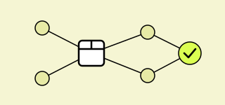

<!-- ───────────── Intro (original content, compact layout) ───────────── -->

::::{div}
:class: edst-hero

```{image} images/EDST-logo/SVG/For-light-themes/EDST-logo-mono-for-light-theme.svg
:alt: UKCEH Environmental Data Science Toolbox logo (light mode)
:class: edst-hero-logo abstract-image abstract-image--light
```

```{image} images/EDST-logo/SVG/For-dark-themes/EDST-logo-mono-for-dark-theme.svg
:alt: UKCEH Environmental Data Science Toolbox logo (dark mode)
:class: edst-hero-logo abstract-image abstract-image--dark
```

:::{div}
:class: edst-hero-text

This is the National Capability UK (NC-UK) Environmental Data Science Toolbox, hosted by the UK Centre for Ecology & Hydrology (UKCEH). The aim is to apply FAIR principles (Findable, Accessible, Interoperable, and Reusable) to a collection of data science methods that are generalizable across different environmental applications, with a focus on integrative modelling. The hope being that this will encourage cross-disciplinary use of methods, enhancing national environmental research.

Please provide some [Feedback](./about_this_project/feedback.md), it's really valued and is utilised in the co-design process!
:::
::::

<!-- ───────────── Search + quick links band ───────────── -->

:::{div}
:class: edst-band

**14** methods · **4** themes · press <kbd>Ctrl</kbd> + <kbd>K</kbd> (<kbd>⌘</kbd> + <kbd>K</kbd> on Mac) to search

{button}`Browse all methods <./data_science_methods.md>` {button}`Contribute a method <./about_this_project/contributing_a_method.md>`
:::

<!-- ───────────── Themes ───────────── -->

## Explore by theme

Pick the environmental question you're working on.

::::{grid} 1 2 2 4
:class: edst-themes

:::{card} Climate, land & Earth observation
:link: data-science-methods#theme-climate


**3 methods** — correcting climate models, satellite crop mapping and risk to terrestrial carbon.
:::

:::{card} Biodiversity & species
:link: data-science-methods#theme-biodiversity


**3 methods** — joint species distribution models, indicator uncertainty and drivers from species accounts.
:::

:::{card} Pollution & chemical exposure
:link: data-science-methods#theme-pollution


**5 methods** — non-target mass spectrometry, metals and PFAS, censored water-quality data.
:::

:::{card} Data integration & FAIR foundations
:link: data-science-methods#theme-data


**3 methods** — packaging data with RO-Crate, testing whether combining datasets pays off, and joining monitoring data through river networks.
:::
::::

{button}`See all 14 methods <./data_science_methods.md>`

<!-- ───────────── Get started ───────────── -->

## Get started

::::{grid} 1 2 2 4
:class: edst-start

:::{card} Use the toolbox
:link: ./about_this_project/utilising_the_toolbox.md
Run the notebooks locally or in the cloud.
:::

:::{card} Template notebook
:link: ./notebook_guidance/template_notebook.ipynb
Start a new method in the house format, Python or R.
:::

:::{card} Get involved
:link: ./about_this_project/get_involved.md
Join the community and shape what comes next.
:::

:::{card} How to cite
:link: ./about_this_project/cite.md
Credit the toolbox and individual methods.
:::
::::
